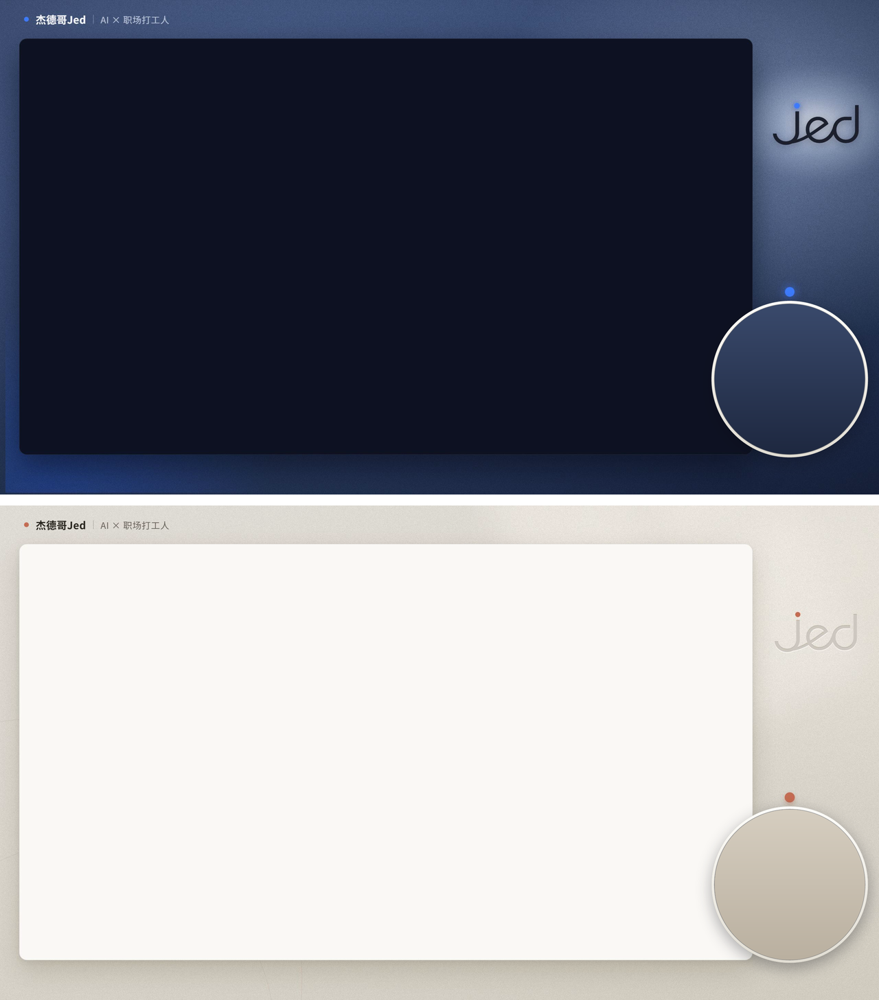
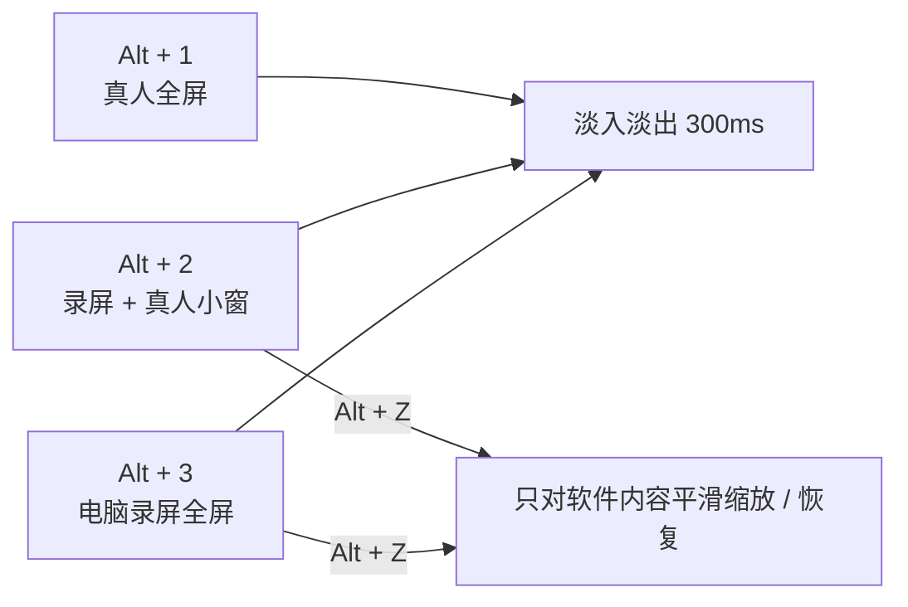

<div align="center">

# OBS Talk Demo Studio

### 一套为中文个人 IP、产品演示与知识分享设计的 OBS 录制工作台

[](https://obsproject.com/)
[](#快速开始)
[](#它解决什么问题)
[](LICENSE)



**少记快捷键，少切重复场景，把注意力留给表达。**

</div>

## 这是什么仓库？

这是一个可复用、可版本管理的 **OBS 录屏配置仓库**。它把场景集合、1440p30 录制参数、音频轨道、极简快捷键、Camo/iPhone 圆形真人小窗、两套品牌循环背景（深蓝工作室 / 暖纸桌面），以及 Zoominator 的干净光标与点击反馈整理到一起。

它不是 OBS 的完整发行版，也不会包含任何人的摄像头 ID、显示器 ID、WebSocket 密码或录屏内容。

## 它解决什么问题

- **快捷键记不住**：三个主场景固定对应 `Alt + 1/2/3`，按画面层级顺序记忆。
- **重点缩放与录屏场景重复**：缩放直接集成进“录屏 + 真人小窗”，只改变软件内容，不切走人物、背景与品牌信息。
- **真人小窗像临时贴图、还挡内容**：440px 圆窗底边与录屏卡片对齐，只压住录屏右下约 112px；暖白实色细环加投影，上方悬一颗品牌圆点，像 jed 里 j 的那个点。
- **小窗里的人太小**：用独立嵌套场景二次放大人物，只裁切小窗，不改变真人全屏。
- **全屏捕获暴露无关内容**：默认增加可手选的窗口捕获来源，可锁定浏览器、PPT 或任意软件。
- **背景像通用科技素材、和本人无关**：两套背景都从个人品牌长出来。深蓝工作室复刻头像里的灰蓝墙面、蓝色补光和背光 jed 墙标；暖纸桌面延续品牌片与领英 banner 的暖纸和陶土色。录屏放进带边框的卡片里，非 16:9 窗口也像有意留边。
- **录制时操作太多**：标题、网址、身份条都留给后期，OBS 画面里只保留不会过时的名字与定位；两套背景在 `02` 场景里点眼睛图标切换，录前选好即可。
- **点击位置偏移、点击效果吵**：按实际捕获窗口客户区与 OBS 场景变换精确换算坐标；点击时箭头按下回弹，加一次约 0.5 秒的柔和扩散，不再是三圈雷达波。
- **录出来的光标又小又乱**：录制画面里用一个 1.5 倍、白底黑描边带柔和投影的干净箭头替换系统光标，不再和准星光环叠在一起；操作者看到的 Windows 系统光标保持不变。
- **配置难以迁移**：机器相关字段全部留空，由安装脚本生成本机配置。

## 三个主场景

| 快捷键 | 动作 | 使用时机 |
|---|---|---|
| `Alt + 1` | 真人全屏 | 开场、总结、强调观点 |
| `Alt + 2` | 电脑录屏 + 真人小窗 | 主力讲解场景 |
| `Alt + 3` | 电脑录屏全屏 | 需要最大可读面积时 |
| `Alt + Z` | 鼠标附近平滑放大 / 恢复 | 在录屏场景里聚焦按钮、表格或关键区域 |
| `Alt + X` | 开 / 关鼠标跟随 | 与 `Z` 相邻，避开浏览器的 `Alt + F` |
| `Alt + R` | 开始 / 停止录制 | 录制控制 |

记忆时只需一直按住 `Alt`：`1/2/3` 管画面，相邻的 `Z/X` 管缩放与跟随，`R` 是 Record。也可以启动不会被录制的[屏幕悬浮控制条](docs/CONTROL_BAR.md)，完全用鼠标点击操作。暂停录制仍从 OBS 面板操作，避免误触。

## 场景设计



**切换背景**：在 `02 电脑录屏 + 真人小窗` 的来源列表里，点「背景 · 深蓝工作室」或「背景 · 暖纸桌面」的眼睛图标，只留一个可见。录制前选好，录制中不用管。

声音通过隐藏的 `00 音频总线` 统一进入三个展示场景：轨道 1 为混音，轨道 2 为麦克风，轨道 3 为系统声音，方便后期独立处理。

## 快速开始

要求：Windows 11、OBS Studio 32+、PowerShell 7（Windows PowerShell 5.1 也可运行安装脚本）。

```powershell
git clone https://github.com/jedliuai/OBS-talk-demo-studio.git
cd OBS-talk-demo-studio
powershell -ExecutionPolicy Bypass -File .\scripts\install.ps1
```

安装前请退出 OBS。脚本会自动备份同名配置，然后安装：

1. 场景集合 `个人IP录制工作台`
2. 配置文件 `个人IP录制_1440p30`
3. Zoominator 极简快捷键配置
4. 深蓝工作室 / 暖纸桌面两套背景与真人圆窗边框
5. 桌面上的 `OBS 控制条` 快捷方式

重开 OBS 后，只需在来源属性里选择自己的软件窗口、Camo/iPhone 摄像头和麦克风。完整步骤见 [安装说明](docs/INSTALL.md) 与 [窗口捕获说明](docs/WINDOW_CAPTURE.md)。

可选：以管理员身份安装可复现构建的增强版 Zoominator（干净光标、点击反馈、死区跟随）：

```powershell
powershell -ExecutionPolicy Bypass -File .\scripts\install-ripple-plugin.ps1
```

## 干净光标与点击反馈

`plugin/zoominator-ripple.patch` 基于 [Zoominator 2.0.6](https://github.com/mmlTools/zoominator/tree/2.0.6) 制作：

- 录制画面里画一个干净箭头替换系统光标：系统箭头的 1.5 倍，白色填充、#111 细描边、圆角转折、柔和投影，4 倍超采样绘制，热点对准箭尖；
- 光标位置有约 60ms 的轻微平滑，去掉抖动；点击效果始终用真实点击坐标；
- 点击时箭头 60ms 内缩到 0.86，松开后约 180ms 弹回，中间轻微过冲到 1.06；
- 点击点出现一次柔和扩散：灰蓝实心圆 13→30px、450ms 淡出，外加 2px 白色细环 24→42px、500ms 淡出，浅色网页和深色编辑器上都看得清；
- 插件只在自己画箭头时隐藏所管理捕获源的系统光标，关掉「用干净的箭头替换系统光标」立即恢复；
- 使用捕获窗口客户区与 OBS 绘制矩阵校正点击坐标；
- 放大后「死区跟随」：鼠标在可视区域中间约 60% 的安全框里移动时画面不动，进入边缘带才用临界阻尼弹簧平滑平移，暂停或恢复跟随都不会跳；
- GitHub Actions 自动从官方源码应用补丁并构建 Windows x64 版本。

发布包下载时会校验 SHA256，安装前自动备份现有 DLL。当前 v1.6.0 Release DLL 的 SHA256 为 `B5A25BAC7012040CE9147BCFB8885C9F5BFEE6CB690CE0E0A982C962A39AA169`。

这部分继承上游 GPL-2.0 许可。仓库不混入闭源二进制，构建过程可以逐行审计。

## 安全与隐私

- 模板中的摄像头与显示器硬件 ID 已清空。
- 仓库不存储 OBS WebSocket 密码。
- 公开预览不使用真实桌面录屏截图。
- 安装脚本只写入当前用户的 `%APPDATA%\obs-studio`，且写入前备份。

## 目录

```text
assets/                 品牌背景素材
motion-background/      轻柔循环背景的 Remotion 源工程
obs/                    脱敏后的场景、配置与插件参数
plugin/                 Zoominator 补丁与说明
scripts/                安装与备份脚本
.github/workflows/      可复现的插件构建流程
docs/                   安装、快捷键与设计决策
worklog/                中文工作总结与演进记录
local-backups/          仅本地备份与验证截图（不上传 GitHub）
```

本地项目已统一归入 `OBS/OBS-talk-demo-studio/`。目录清理、历史资料和后续同步方式见[项目整理说明](docs/ORGANIZATION.md)。后续有效修改完成验证后，及时提交并推送 GitHub；维护约定见 [AGENTS.md](AGENTS.md)。

## 致谢

- [OBS Studio](https://obsproject.com/) — 录制与直播基础设施
- [Zoominator](https://github.com/mmlTools/zoominator) — 鼠标跟随缩放与点击标记
- [OBS-MCP](https://github.com/Tom-R-Main/OBS-MCP) — 自动化配置与验证

---

<div align="center">
Made for calm, readable, camera-friendly demos.
</div>
